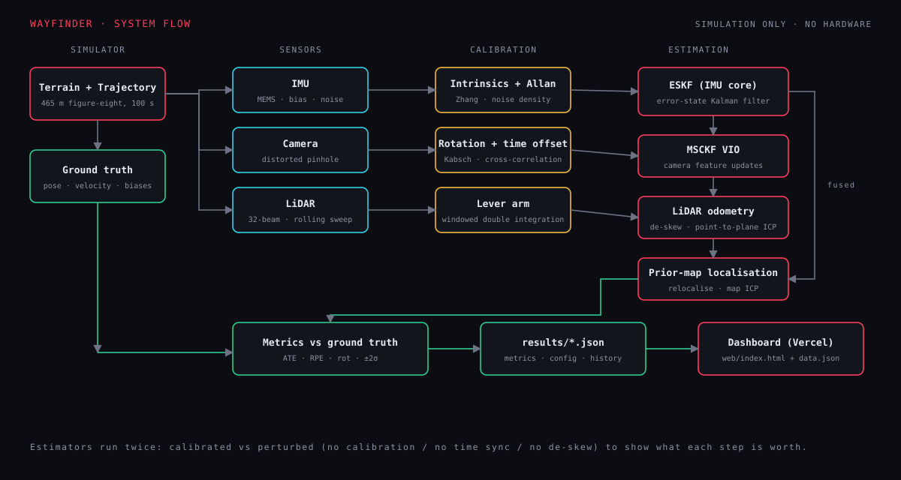

# Wayfinder

**Live dashboard:** https://wayfinder-sepia-one.vercel.app

[](https://wayfinder-sepia-one.vercel.app)


## System flow



State estimation and sensor calibration for a UAV flying outdoors with an IMU, a camera and a spinning LiDAR.
Written from scratch in Python (NumPy, SciPy, OpenCV): calibration and time synchronisation, LiDAR motion
compensation, MSCKF visual-inertial odometry, LiDAR-inertial odometry and map-based localisation, all scored against ground truth.

> **Scope, stated plainly.** Everything here runs on a *simulated* vehicle, sensors and terrain.
> No real UAV, sensor rig or recorded dataset was used. The simulator is deliberately imperfect (sensor noise, bias
> random walk, lens distortion, rolling LiDAR sweep, outliers, clock offsets, CAD errors, a changed scene), but
> it is still a simulator. Results will not transfer one-to-one to hardware.

The dashboard in `web/` is a static page (animated pipeline, 3-D flight replay, sensor monitor, state estimation with uncertainty, calibration and localisation views, experiment settings and export).

## Results

Single 100 s figure-eight flight, 465 m path, 22–27 m above ground. ATE is RMSE after SE(3) alignment, RPE over 5 s windows.

| Configuration | ATE (m) | RPE 5 s (m) | Rot. RMSE (°) | End drift |
|---|---|---|---|---|
| IMU only | 156.351 | 38.443 | 12.17 | 120.50 % |
| VIO (MSCKF) | 0.580 | 0.491 | 0.37 | 0.14 % |
| LIO | 0.138 | 0.087 | 0.18 | 0.03 % |
| VIO + LIO | 0.081 | 0.059 | 0.11 | 0.03 % |
| VIO, uncalibrated | 10.187 | 7.553 | 7.01 | 6.62 % |
| LIO, uncalibrated | 3.252 | 1.586 | 1.43 | 2.35 % |
| VIO, no time sync | 0.838 | 0.826 | 0.49 | 0.29 % |
| LIO, no time sync | 0.159 | 0.093 | 0.27 | 0.02 % |
| VIO, CAD lever arm | 0.587 | 0.501 | 0.38 | 0.14 % |
| LIO, no de-skew | 0.376 | 0.223 | 0.69 | 0.26 % |

Highlights:

* Fusing camera and LiDAR gives **0.081 m** ATE; LiDAR-inertial alone 0.138 m; MSCKF VIO alone 0.58 m.
* Rolling-sweep distortion matters: without motion compensation LIO degrades from 0.138 m to 0.376 m.
* Skipping calibration is expensive: 10.2 m (VIO) and 3.25 m (LIO).
* A camera clock error of 5 / 10 / 20 / 40 ms raises VIO ATE to 0.68 / 0.86 / 1.32 / 2.27 m (from 0.58 m).
* The 3 cm CAD lever-arm error barely moves VIO ATE (0.59 m with CAD vs 0.58 m estimated): it is below this filter's noise floor, so the lever-arm result is a calibration-accuracy result, not an odometry gain.

### Calibration

| Quantity | Truth | Estimate | Note |
|---|---|---|---|
| Camera fx / fy (px) | 420.0 / 418.0 | 419.9 / 417.9 | 25 checkerboard views, reprojection RMS 0.34 px |
| Gyro white noise | 1.70e-04 | 1.70e-04 | Allan deviation, 2 h static log |
| Accel white noise | 2.00e-03 | 2.00e-03 | Allan deviation |
| Camera→IMU rotation | n/a | 0.14° error | CAD was 3.01° off |
| LiDAR→IMU rotation | n/a | 0.07° error | CAD was 3.09° off |
| Camera time offset | 12.3 ms | 12.15 ms | 0.15 ms error |
| LiDAR time offset | -7.1 ms | -7.27 ms | 0.17 ms error; **44.7 ms without motion compensation** |
| Camera lever arm | [0.12, 0.02, -0.06] | [0.121, 0.021, -0.061] | 0.21 cm error, CAD was 3.09 cm |
| LiDAR lever arm | [0.0, 0.0, 0.09] | [-0.011, 0.052, 0.092] | 5.29 cm error, CAD was 2.77 cm: **not adopted** |

### Map-based localisation

The prior map is built from an earlier survey flight (its own surface sample of the terrain) using the flight's *estimated*
VIO+LIO poses (survey ATE 0.098 m), so the map carries drift and noise. The live flight uses a different
trajectory, an independent surface sample and a changed scene (12% of trees removed, 4 boxes added).

* Kidnapped start: a guess 6.2 m / 35° off is recovered to 0.17 m / 0.86°.
* Tracking against the map: **0.196 m** absolute RMSE (no alignment). LiDAR odometry alone on the same flight: 0.975 m, ending 0.44 m off.
* Relocalisation from random offsets (up to 7 m, 40°): 84 % success over 25 trials (< 0.5 m and < 2 deg), median error 0.373 m.

### Filter consistency

The dashboard's *State estimation → Uncertainty* tab plots each error against the filter's own ±2σ band. MSCKF VIO is roughly consistent. The LiDAR-aided filters are **over-confident**: for VIO+LIO only 39 / 26 / 7 % of position samples fall inside ±2σ (X / Y / Z; about 95 % is expected). ICP errors are correlated in time, but the update treats each scan as independent. Accuracy (ATE) is unaffected; the reported covariance is too small. Inflating the LiDAR noise or modelling the correlation is the obvious next fix.

## How it works

| Module | What it does |
|---|---|
| `wayfinder/sensors.py`, `world.py`, `trajectory.py` | Procedural terrain/trees/buildings; flatness-based quadrotor trajectory; MEMS IMU, distorted pinhole camera, rolling-sweep 32-beam LiDAR |
| `calib/intrinsics.py` | Checkerboard intrinsics and distortion |
| `calib/imu_noise.py` | Allan-variance noise identification |
| `calib/extrinsic_time.py` | Sensor→IMU rotation, time offset and gyro bias: rotation-rate cross-correlation, Kabsch, joint robust refinement. Two-pass gyro de-skew for LiDAR |
| `calib/lever_arm.py` | Lever arm from a target-based bench sequence: windowed double integration of the IMU, no numerical differentiation of poses |
| `estimation/eskf.py`, `msckf.py` | Error-state Kalman filter; MSCKF update (sliding window, null-space projection, chi-square gating) |
| `estimation/lidar_odom.py` | Point-to-plane ICP, local map, prior map, exact SE(3) constant-twist de-skew |
| `estimation/pipeline.py` | Event-driven fusion loop, global relocalisation |
| `eval.py` | ATE / RPE |

Things that took some figuring out (and are in the code comments):

* Without motion compensation, scan-to-scan rotations are effectively stamped mid-sweep, so the LiDAR-IMU time offset comes out ~52 ms wrong.
* Differentiating target poses twice (even with a good spline) bakes in a systematic error; integrating the IMU over short windows and fitting positions does not.
* Planar-target PnP is only accurate when the target fills the view; a small, distant board gave ~30 mm pose errors against ~2 mm for a large, near one.
* A GCV-selected smoothing spline silently collapsed to a straight line on this data; a fixed-knot least-squares B-spline did not.

## Limitations

* Simulation only; the first thing to do next is run the same code on EuRoC / Newer College sequences and then on a real rig.
* Camera feature tracks are idealised (true IDs plus noise, dropouts, 2 % outliers). There is no detector/KLT stage.
* The LiDAR lever arm could not be improved over CAD with an online filter state here (the estimate settled 5.3 cm off), so the CAD value is used. A structured calibration scene would likely be needed.
* Filter initial pose and velocity are taken from ground truth, as is common for simulated odometry benchmarks.

## Run it

```bash
pip install -r requirements.txt
pytest -q                        # unit tests (about 10 s)
python scripts/run_all.py        # all experiments, about 15 min on 2 cores; writes results/metrics.json and web/data.json
python -m http.server -d web     # dashboard on http://localhost:8000
```

Deploy `web/` as a static site (the included `vercel.json` already points at it).

## Author

Lakshay
